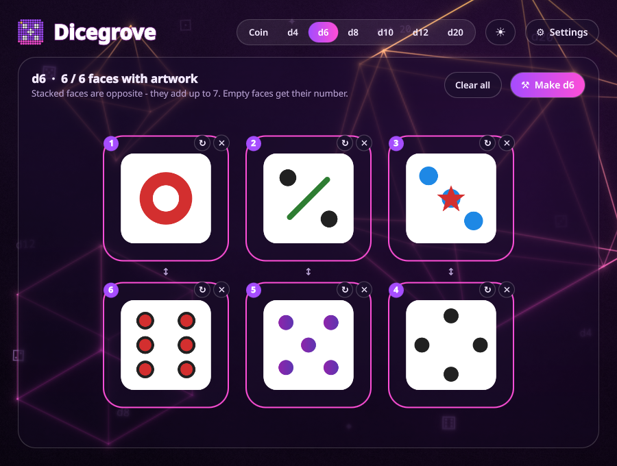
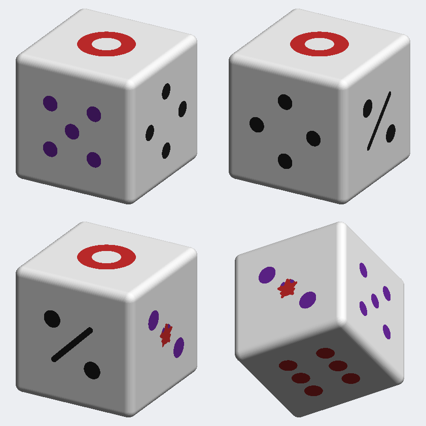

# Dicegrove

Multi-color dice (and coins) for 3D printing, made from SVG artwork: one SVG per face,
d4 / d6 / d8 / d10 / d12 / d20, or a coin with two sides.



The colors of the SVGs become separate parts that fit together exactly:

| part | what it is |
|---|---|
| core | the die, with pockets 0.4 mm deep (adjustable) where the colors go |
| color N | one inlay part per color, fills its pockets flush with the surface |

Everything shares one origin, so in the slicer the parts form **one object with several parts**,
and each part gets its own filament. Ready-made 3MF files for OrcaSlicer / Bambu Studio and
PrusaSlicer already have the filaments assigned.



There are two ways to use it:

- **Dicegrove** - a drag & drop app: pick the die, drop one SVG on each face, press *Make*.
- **dicemaker.py** - the same engine on the command line.

## Download (Windows)

Grab `Dicegrove.exe` (the app) and/or `dicemaker.exe` (command line) from the
[latest release](../../releases/latest). Both are single self-contained files - no Python needed.
Builds of every commit are also on the [Actions](../../actions) page (artifact *dicegrove-windows*).

Windows may warn about an unknown publisher the first time (the exe is not code-signed):
*More info → Run anyway*.

## Run from source (macOS / Linux / Windows)

Needs Python 3.10+.

```bash
python3 -m pip install -r requirements.txt
python3 Dicegrove/main.py                  # the app
python3 dicemaker.py                       # command line: d6 from the sample SVGs in examples/d6
```

On Linux, `Dicegrove/install.sh` adds a menu entry, an icon and "Open with" for SVG files
(per user, `~/.local`). On Fedora/Nobara you can also take PySide6 from the distribution:
`sudo dnf install python3-pyside6`.

## The app: Dicegrove

- Choose the die in the header. There is one drop field per face, shaped like the face, laid out
  in **opposite pairs** - stacked faces add up to sides + 1, like on real dice (1 ⟷ 6 on a d6).
  A coin has *Heads* (top) and *Tails* (underneath).
- Drop an SVG on a field, or click it. Several SVGs or a folder fill the following faces in
  file-name order. Empty faces get their number. **↻** turns an image by 90°.
- **Make** queues the die. Output goes to a folder beside your artwork (`crests/` → `crests_d6/`):
  part STLs, both 3MF files, `preview.png` and `report.txt` (color table, warnings).
- Every setting of the engine is in *Settings*. More in [Dicegrove/README.md](Dicegrove/README.md).

## Command line: dicemaker.py

```bash
python3 dicemaker.py                       # d6 from the sample SVGs in examples/d6
```

Output goes to `out/d6/`:

- `1_core_ffffff.stl`, `2_color2_d32f2f.stl`, ...: the leading number is the filament slot
- `dice_d6_orca_bambu.3mf`: for OrcaSlicer / Bambu Studio, one object with parts that already have their filaments
- `dice_d6_prusa.3mf`: the same for PrusaSlicer (each slicer ignores the other one's layout, so there are two files)
- `preview.png`: four views of the colored die

The script also prints a **color table**. The color numbers in it are the ones you use for `CORE_COLOR_INDEX`.
`dicemaker.exe` on Windows works the same way and writes `out/` into the current folder.

### Settings

All settings are in the **CONFIG** block at the top of `dicemaker.py`. The main ones:

| setting | default | meaning |
|---|---|---|
| `DIE_SIDES` | 6 | 4, 6, 8, 10, 12, 20, or 2 = coin |
| `DIE_SIZE_MM` | None | face to face (coin: diameter); None = typical size |
| `FACE_SVGS` | examples | list in face order (`None` = auto number), or a folder |
| `INLAY_DEPTH_MM` | 0.4 | pocket depth |
| `MAX_COLORS` | 4 | SVG colors are merged (by similarity) down to this many |
| `CORE_SHARES_COLOR` | True | the core is printed in one of the SVG colors, which is then not cut out |
| `CORE_COLOR_INDEX` | 1 | which color the core shares (1 = largest area) |
| `PALETTE` | None | your real filament colors, e.g. `["#fff", "#d32f2f", ...]`; SVG colors snap to them |
| `IGNORE_COLORS` | [] | colors treated as background (the core shows there) |
| `EDGE_ROUNDING` | minkowski | `none`, `minkowski` (rounded edges), `sphere` (classic dice look) |
| `MIN_FEATURE_MM` | 0.4 | details thinner than this cannot be printed (nozzle width) |
| `THIN_DETAILS` | merge | `merge`: a thin color strip joins its neighboring color (shapes stay); `remove`: it becomes core color; `keep`: nothing is filtered, you only get a warning plus the die size at which it would print |
| `FACE_ROTATIONS` | {} | extra rotation per face, e.g. `{3: 90}` |
| `FIT_TO` | content | `content` = fill the face, `viewbox` = keep the SVG page framing |
| `UNIFORM_SCALE` | False | the same scale for all SVGs (for icon sets that share one viewBox) |
| `COIN_THICKNESS_MM` / `COIN_EDGE_MM` | 3.0 / 0.6 | coin thickness and edge rounding |
| `COIN_LABELS` | H, T | text for a coin side without an SVG |

Command-line options override the config:

```bash
python dicemaker.py --sides 20 --svgs                  # d20 with numbers only
python dicemaker.py --sides 6 --svgs my_faces/         # folder: 1.svg ... 6.svg
python dicemaker.py --sides 8 --svgs a.svg b.svg       # faces 3-8 get numbers
python dicemaker.py --separate-core --colors 5 --depth 0.6 --rounding sphere
python dicemaker.py --coin --size 35 --svgs heads.svg tails.svg   # coin, 35 mm
python dicemaker.py --thin keep           # no filtering, just warnings + size advice
```

#### Thin details

The script prints a table per face. It shows how much of the colored shape is printable (`shape kept`) and how much changed color (`recolored`). When a lot is lost, it says by how much to scale up, e.g. `--size 40`, or which `MIN_FEATURE_MM` would be needed. Detailed traced artwork with many hairline highlights needs a bigger die or a coin: such art keeps ~55–75% of its shape on a 16 mm d6, ~90–95% on a 35–40 mm coin.

## How it works

1. **Die**: a convex hull of the polyhedron's corners. Rounded edges come from a hull of small spheres, so the flat faces stay exactly in place. One face lies on the print bed, and opposite faces add up to N+1.
2. **SVG**: every filled shape (paths, rects, circles, ...) and every stroke becomes an area. Transforms, `evenodd` / `nonzero`, holes and gradients (averaged to one color) are handled. Shapes drawn later cover earlier ones, so only what you actually *see* in the SVG gets cut. `<text>` is not supported: convert it to paths first (Inkscape: *Path > Object to Path*).
3. **Colors**: collected over all faces, so color 2 is the same filament on every face.
4. **Placement**: each image is scaled as large as fits inside the flat face area (minus `FACE_MARGIN_MM`), times `IMAGE_SCALE`. Auto numbers all get the same size.
5. **Parts**: built with manifold3d booleans. `core = die - pockets` and `inlay = pocket ∩ die`, so the parts never overlap and add up to the full die. All 2D work runs on a 1 µm grid. Places where an area touches itself in a single point get a 0.02 mm hole, because a point contact would become a non-manifold edge in the file.

## Printing tips

- Pockets on the top and bottom faces are counted in **layers**, so make the depth a multiple of your layer height (the script warns otherwise). Pockets on side faces are counted in **line widths**: 0.4 mm = one nozzle line, and 0.8 mm is more robust.
- Print on a face (the 3MF is already oriented that way). d4/d8/d10/d12/d20 need supports or a brim on their lower faces.
- Use a prime tower and enough purge for light colors next to dark ones.

## Tests

```bash
python3 tests/verify.py                                   # engine: all dice, watertight, no overlaps
cd Dicegrove && python3 -m unittest tests.test_core       # app core
```

`Dicegrove/dicegrove/engine.py` is a copy of `dicemaker.py` (so the app can be installed on its
own). After changing `dicemaker.py`, copy it over - the CI build fails if the two differ.

## Building the Windows exe yourself

```bash
pip install -r requirements.txt pyinstaller
pyinstaller packaging/dicegrove.spec        # dist/Dicegrove.exe
pyinstaller packaging/dicemaker.spec        # dist/dicemaker.exe
```

The GitHub workflow (`.github/workflows/build.yml`) does this on every push, runs the tests and a
self-test of both exes, and attaches them to a release when a tag `v*` is pushed.

## License

MIT - see [LICENSE](LICENSE).
